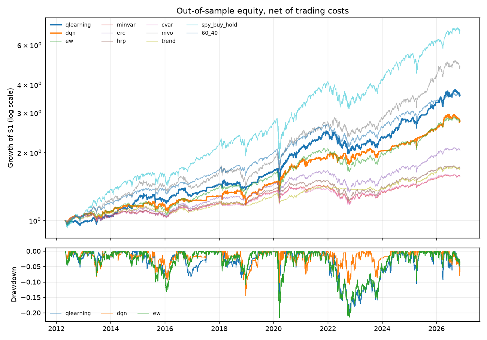

# rlfolio

An event-driven backtester and portfolio optimizer in which reinforcement learning agents decide how to allocate capital across classical optimizers. It covers the path from market data to a paper-trading order: walk-forward training, realistic execution costs, statistical validation, and order generation.

**Result in brief:** over 14.5 years of out-of-sample ETF data, tabular Q-learning delivered a Sharpe ratio of 0.91 (average of 8 seeds), ahead of equal weight (0.75) and SPY (0.89) but behind a 60/40 portfolio (0.95). None of these differences is statistically significant. The DQN agent averaged 0.71 and was unstable across seeds. See [Results](#results) before drawing conclusions.



## What's inside

| Layer | Module | What it does |
| --- | --- | --- |
| Data | `data.py` | Yahoo Finance (adjusted, cached), CSV, and a regime-switching synthetic market |
| Engine | `engine.py`, `events.py` | Event loop in which orders decided at the close fill at the next open |
| Execution | `execution.py` | Commissions, spread, square-root market impact, ADV participation caps, cash limits, risk limits, drawdown circuit breaker |
| Optimizers | `optimize.py` | Ledoit-Wolf shrinkage, min variance, mean-variance, equal risk contribution, hierarchical risk parity, min CVaR |
| RL | `agents.py`, `sleeves.py` | Double Q-learning and an ensemble of Double Dueling DQNs with prioritized replay, written in NumPy |
| Validation | `study.py`, `analytics.py` | Embargoed walk-forward folds, deflated Sharpe ratio, stationary bootstrap |
| Trading | `live.py`, `cli.py` | Order tickets from the latest close, with optional Alpaca **paper** execution |

## How it works

```
             at the close of bar t                     at the open of bar t+1
┌──────────┐   ┌───────────┐   ┌──────────┐   ┌──────┐   ┌────────┐   ┌───────────┐
│  Market  │ → │ RL agent  │ → │ Sleeve   │ → │ Risk │ → │ Orders │ → │ Simulated │
│  regime  │   │ picks an  │   │ weights  │   │checks│   │        │   │ broker    │
│ features │   │ action    │   │          │   │      │   │        │   │ fills     │
└──────────┘   └───────────┘   └──────────┘   └──────┘   └────────┘   └───────────┘
```

**The agent chooses among optimizers rather than outputting raw weights.** Each week it picks one of 11 actions: hold cash, or run one of five portfolios (equal weight, min variance, risk parity, mean-variance with momentum, trend following) at 50% or 100% exposure. A few thousand daily observations can't support learning raw weights, but they can support learning which method suits the current regime.

**Returns are treated as exogenous.** A small trader doesn't move the market, so the reward of every action at every historical step can be calculated exactly. Both agents learn from these counterfactual outcomes, which greatly increases the usable training data.

**Rewards are measured relative to equal weight.** The reward is risk-adjusted log growth, net of trading costs, minus the same utility for the equal-weight portfolio. The baseline doesn't depend on the action, so the optimal policy is unchanged while much of the market noise is removed.

## Quick start

Requires Python 3.10 or newer.

```bash
git clone https://github.com/cwford06/rlfolio.git
cd rlfolio
python -m venv .venv && source .venv/bin/activate
pip install -e ".[all]"

pytest                                          # run the tests
rlfolio backtest --source synthetic --out demo  # offline demo
rlfolio backtest --out results                  # real ETF data, about 2 minutes
```

### Generate orders

```bash
# Dry run: writes orders.csv and sends nothing
rlfolio signal --capital 100000 --positions positions.json --agent qlearning

# Alpaca paper trading
export ALPACA_API_KEY=...  ALPACA_API_SECRET=...
rlfolio signal --alpaca-paper           # reads the paper account, sends nothing
rlfolio signal --alpaca-paper --submit  # submits orders to the paper account
```

`positions.json` maps symbols to shares held, for example `{"SPY": 10, "TLT": 25}`. The Alpaca client is hard-coded to the paper endpoint and has no live-trading option. It has been tested against a mock transport only, so check its first orders in your paper account.

## Results

Test period: April 30, 2012 to November 13, 2026, across 15 yearly walk-forward folds. The universe is SPY, QQQ, IWM, EFA, EEM, VNQ, TLT, IEF, LQD, HYG, GLD and DBC, with $1M starting capital. All figures are net of modeled trading costs. Cash earns no interest.

| Strategy | CAGR | Volatility | Sharpe | Max drawdown | Turnover/yr |
| --- | --- | --- | --- | --- | --- |
| 60/40 (SPY/IEF) | 9.18% | 9.77% | 0.95 | 21.11% | 0.16x |
| Mean-variance + momentum | 11.39% | 12.45% | 0.93 | 20.02% | 5.27x |
| **Q-learning (seed 7)** | **9.20%** | **10.15%** | **0.92** | **20.64%** | **8.85x** |
| SPY buy and hold | 14.28% | 16.55% | 0.89 | 33.60% | 0.01x |
| Trend following | 3.69% | 4.61% | 0.81 | 10.00% | 1.76x |
| **DQN (seed 7)** | **7.25%** | **9.34%** | **0.80** | **14.54%** | **9.56x** |
| Equal weight | 7.22% | 9.99% | 0.75 | 21.67% | 0.12x |
| Risk parity | 5.05% | 7.21% | 0.72 | 20.28% | 0.23x |
| Min variance | 3.12% | 5.35% | 0.60 | 17.08% | 0.51x |
| Hierarchical risk parity | 3.74% | 6.46% | 0.60 | 19.63% | 1.29x |
| Min CVaR | 3.13% | 5.53% | 0.58 | 17.02% | 1.11x |

### How much to trust these numbers

| Check | Q-learning | DQN |
| --- | --- | --- |
| Mean Sharpe across 8 seeds | 0.905 | 0.711 |
| Range across seeds | 0.875 to 0.930 | 0.547 to 0.860 |
| Sharpe at 2x trading costs (seed 7) | 0.885 | 0.756 |
| Sharpe at 4x trading costs (seed 7) | 0.819 | 0.678 |
| Sharpe vs equal weight, 95% CI (seed 7) | +0.17 (-0.12 to +0.45) | +0.05 (-0.28 to +0.35) |
| Sharpe vs 60/40, 95% CI (seed 7) | -0.03 (-0.35 to +0.27) | -0.15 (-0.52 to +0.19) |

- **No agent shows a statistically significant edge.** Every confidence interval above includes zero.
- **Q-learning is the more dependable agent.** Its results barely change with the seed. The DQN's seed sensitivity is too large to rely on any single run.
- **The agents trade far more than the simple benchmarks.** Their edge shrinks as costs rise, while 60/40 is almost unaffected.
- **The test period favored US stocks and bonds together**, which flatters 60/40 and SPY.

Full output is in [`results/report.md`](results/report.md) and [`results/robustness.csv`](results/robustness.csv). To reproduce the robustness checks, run `python scripts/robustness.py`.

## Safeguards against backtest bias

| Risk | Safeguard | Test |
| --- | --- | --- |
| Lookahead in features or weights | Calculated only from trailing bars | Results are identical when future bars are removed or scrambled |
| Leakage into training | Training stops at an embargoed cut before each test year | Trained policies are identical when prices after the cut are scrambled |
| Same-bar execution | Orders fill at the next open | Fill dates are asserted directly |
| Accounting errors | Cash, positions and costs are tracked per fill | Cash reconciles to the fill ledger, and a frictionless buy-and-hold matches its analytic value |
| Unrealistic liquidity | Participation capped at 5% of trailing ADV | Fill sizes are asserted directly |
| Selection bias | Every strategy counts as a trial | Deflated Sharpe ratio and bootstrap intervals |

## Limitations

- Daily bars can't capture intraday liquidity, and opening auction prices are assumed to be achievable.
- Cost parameters are estimates and haven't been calibrated to real fills.
- Adjusted prices model dividends as reinvested and ignore taxes.
- The ETF universe was chosen with hindsight, although all 12 funds existed for the whole test period.
- Hyperparameters were set by judgment and were not tuned on the test period, but the author saw results while building the system.

## License

MIT. This project is for research and education and is not investment advice. Backtested performance doesn't guarantee future results.
